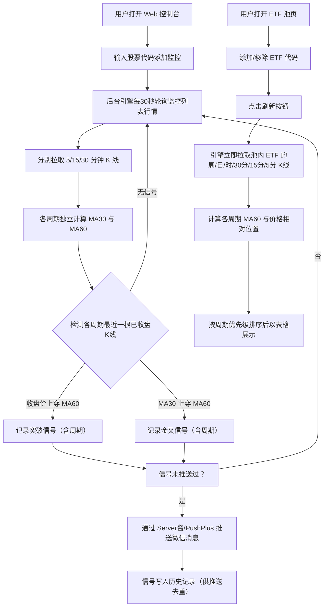

# 股票盯盘小助手 - 产品需求文档（PRD）

## 1. 产品概述

一款本地运行的股票盯盘助手：用户添加指定的 A 股股票代码后，系统实时轮询行情数据，自动检测「股价刚突破 5 分钟 60 均线」与「5 分钟 30 均线刚上穿 60 均线（均线金叉）」两类信号，并通过微信（Server酱 / PushPlus）第一时间推送提醒。另提供独立的「ETF 池」页面，以表格形式集中展示多只 ETF 在六个 K 线周期上的 60 均线状态，便于快速把握整体多空格局。
- 目标用户：个人 A 股投资者，需要盯盘但无法长时间守在屏幕前
- 产品价值：自动化技术信号监测 + 微信触达，替代人工盯盘，捕捉短线启动时机；ETF 池提供多标的 × 多周期的全局视图

## 2. 核心功能

### 2.1 用户角色
| 角色 | 注册方式 | 核心权限 |
|------|----------|----------|
| 单用户（本地工具） | 无需注册 | 全部功能：配置监控、管理 ETF 池、接收通知 |

### 2.2 功能模块
1. **监控管理页**：股票监控列表（卡片式），添加/删除监控股票，查看每只股票的实时价格与 5/15/30 分钟三周期的均线状态（同屏展示、无需切换）；卡片支持拖拽排序与置顶
2. **ETF 池页**：独立于监控列表的 ETF 收藏池，用户自行添加/移除 ETF 代码；以表格展示每只 ETF 在周线/日线/小时/半小时/15分钟/5分钟六个周期上「价格是否站上 60 均线」，并按周期优先级排序（在均线上的排前面）；仅在点击「刷新」时拉取最新数据，不自动轮询
3. **通知设置面板**：配置微信推送渠道（Server酱 SendKey 或 PushPlus Token），发送测试通知验证连通性
4. **常驻监控引擎**（后台）：交易时段自动轮询行情 → 对监控列表每只股票的 5/15/30 分钟周期分别计算均线 → 检测信号 → 微信推送；ETF 池不参与定时轮询，仅在手动刷新时更新

### 2.3 页面详情
| 页面名称 | 模块名称 | 功能描述 |
|-----------|-------------|-------------|
| 监控管理页（首页） | 监控卡片列表 | 以卡片展示每只监控股票：名称/代码、大号等宽最新价（3 位小数）、5/15/30 分钟三个周期的均线状态徽标（「价格在60线上方/下方」「均线已金叉/待金叉」）同屏并排展示 |
| 监控管理页（首页） | 添加监控 | 输入 6 位股票代码自动识别沪深北市场，校验后加入监控 |
| 监控管理页（首页） | 拖拽排序与置顶 | 卡片拖拽把手调整顺序（顺序持久化），置顶按钮将卡片排到最前 |
| ETF 池页 | 添加 ETF | 点击「添加」展开表单，输入 6 位 ETF 代码加入池中（独立于监控列表） |
| ETF 池页 | 均线状态表格 | 表头：序号、股票名称、周线、日线、小时、半小时、15分钟、5分钟；单元格显示「上/下」徽标（上=价格在 60 均线上方，绿；下=在下方，红），悬停显示具体价格与偏离百分比 |
| ETF 池页 | 排序规则 | 按周期优先级逐列比较：周线（第一优先级）→ 日线 → 小时 → 半小时 → 15分钟 → 5分钟；在均线上者排前面，同状态继续比较下一优先级周期 |
| ETF 池页 | 手动刷新 | 不自动轮询；点击「刷新」触发引擎立即拉取池内全部 ETF 的六个周期 K 线并更新表格（按钮显示刷新中状态） |
| ETF 池页 | 移除 ETF | 行内删除按钮，从池中移除 |
| 通知设置 | 渠道配置 | 选择 Server酱 或 PushPlus，填入对应 Key/Token，一键发送测试消息；测试结果即时反馈 |
| 通知设置 | 系统状态 | 显示监控引擎运行状态、下一次轮询倒计时、今日已推送条数 |

### 2.4 信号检测规则（核心业务逻辑）
- 数据基础：对每只**监控列表**股票同时拉取 **5 分钟、15 分钟、30 分钟** 三种周期 K 线（收盘价），各自独立计算 MA30 与 MA60；ETF 池股票额外拉取小时/日线/周线用于展示，不参与信号推送
- **突破信号**（按周期独立检测）：某周期最近一根已收盘 K 线的收盘价上穿其 MA60（前一根收盘价 ≤ 前一根 MA60，当前根收盘价 > 当前根 MA60）
- **金叉信号**（按周期独立检测）：某周期最近一根已收盘 K 线的 MA30 上穿 MA60（前一根 MA30 ≤ 前一根 MA60，当前根 MA30 > 当前根 MA60）
- 去重规则：每根 K 线每类信号最多推送一次（按 股票+周期+信号类型+K线时间 唯一约束）；同一股票同一根 K 线若同时触发两类信号，合并为一条推送
- 交易时段：周一至周五 9:30–11:30、13:00–15:00（北京时间）内轮询监控列表，每 30 秒一次（三种周期同轮拉取）；收盘后同样轮询（K 线均为已收盘数据，信号幂等去重不会重复推送），并对未推送信号补偿推送
- **ETF 池更新机制**：完全手动触发——仅当用户点击「刷新」时，引擎才拉取池内 ETF 的六周期 K 线并更新快照

## 3. 核心流程

## 4. 用户界面设计

### 4.1 设计风格
- **整体基调**：专业金融终端风，致敬 Bloomberg Terminal 的数据密度与克制感，信息第一、装饰第二
- **主题**：支持白天/黑夜双主题，顶栏一键切换（CSS 变量 + TailwindCSS darkMode: class）
- **暗色主色**：近黑底色 `#0B0E14`，面板 `#11151E`，边框 `#1E2430`
- **强调色**：信号金 `#F5B94A`（金叉）、突破青 `#4AC8F5`（突破）；涨跌遵循 A 股习惯（红涨 `#E5484D` / 绿跌 `#3DD68C`）
- **字体**：数字与代码用等宽字体 IBM Plex Mono，中文正文用 Noto Sans SC，标题加粗紧凑
- **价格精度**：统一显示 3 位小数
- **按钮**：直角微圆角（4px）、描边式为主，主操作实心填充；悬停有 1px 亮边反馈
- **布局**：顶栏（品牌 + 导航 + 状态灯 + 时钟 + 主题切换）→ 页面内容；数据密度高、留白克制
- **图标/表情**：信号用少量符号（⭐🚀）与文字标签结合，其余用极简线性图标
- **动效**：刷新指示灯呼吸闪烁；页面载入卡片错落渐入

### 4.2 页面设计概览
| 页面名称 | 模块名称 | UI 元素 |
|-----------|-------------|-------------|
| 监控管理页 | 顶栏 | 左侧产品名，中间导航（监控/ETF 池/设置），右侧引擎状态灯 + 时钟 + 主题切换 |
| 监控管理页 | 监控卡片 | 网格布局：股票名/代码、大号等宽最新价（3 位小数，红/绿）、三周期均线状态徽标行（「价格在60线上方」「均线已金叉」等）；悬停显示拖拽把手/置顶/删除按钮 |
| ETF 池页 | 工具栏 | 池内数量、排序规则说明、添加按钮（展开内联表单）、刷新按钮（含加载态） |
| ETF 池页 | 状态表格 | 列：序号 / 股票名称（含代码）/ 周线 / 日线 / 小时 / 半小时 / 15分钟 / 5分钟 / 操作；单元格为红绿「上/下」徽标，悬停显示价格与偏离百分比 tooltip；行悬停显示删除按钮 |
| 通知设置 | 表单 | 渠道单选卡（Server酱/PushPlus）、Key 输入框、测试按钮 + 结果 toast |

### 4.3 响应式
桌面优先设计；窄屏下监控卡片由多列网格折叠为单列，ETF 池表格横向滚动（最小宽度 760px），触控目标 ≥ 40px。

## 5. 非功能需求
- **可靠性**：网络/接口异常自动重试并记录日志，单次失败不影响引擎存活
- **通知时效**：信号触发后 30 秒内完成微信推送
- **数据留存**：监控列表、ETF 池、信号历史、通知配置本地持久化，重启不丢失
- **隐私**：所有数据仅存本地，Key 仅本地存储
