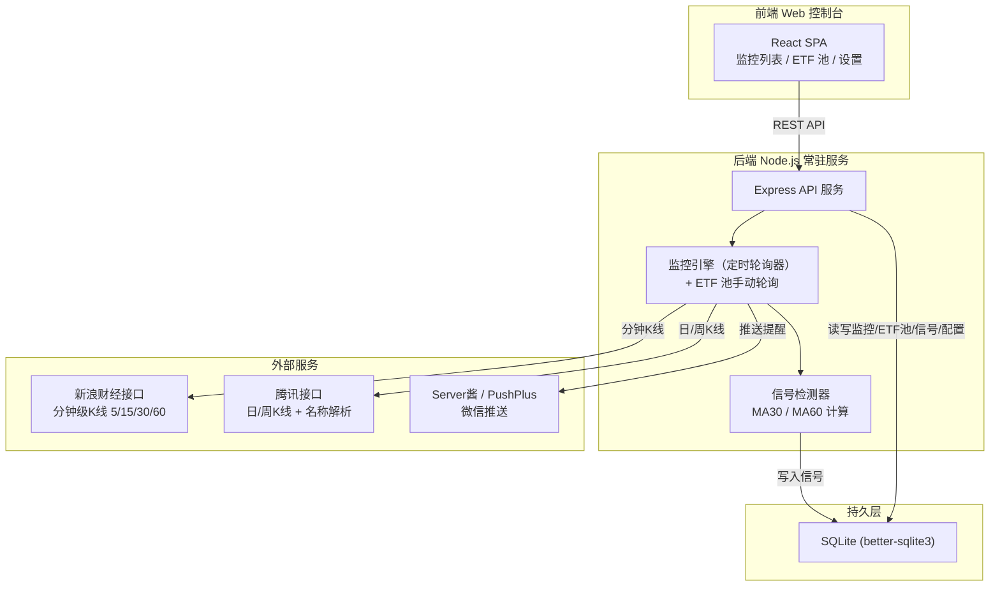
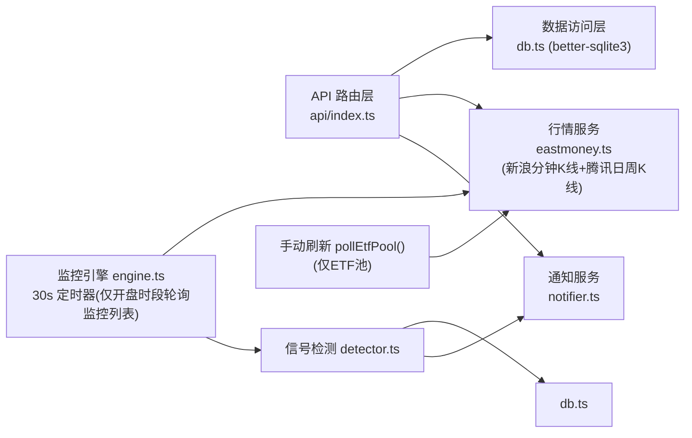
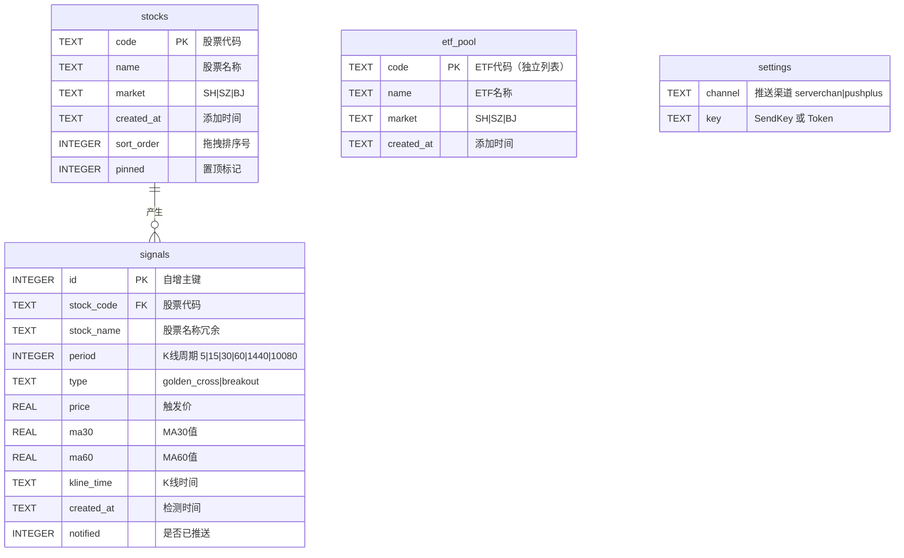

# 股票盯盘小助手 - 技术架构文档

## 1. 架构设计



## 2. 技术说明

- **前端**：React@19 + TypeScript + Vite + TailwindCSS@3（darkMode: class 双主题），react-router-dom 路由，@dnd-kit 拖拽排序，lucide-react 图标；等宽字体 IBM Plex Mono + Noto Sans SC
- **后端**：Node.js + Express@4 + TypeScript（tsx 直跑）；内置 `setInterval` 监控引擎（单进程常驻）
- **数据库**：SQLite（better-sqlite3，本地文件 `data/stock-watch.db`），零外部依赖，WAL 模式
- **开发/运行**：`npm run dev`（前后端并行开发模式）；`npm run build && npm start`（生产模式，Express 托管前端静态资源，单端口 3000）
- **行情数据源**：
  - 分钟级 K 线（5/15/30/60 分钟）：新浪财经 `https://quotes.sina.cn/cn/api/jsonp_v2.php/.../CN_MarketDataService.getKLineData`（免 Key，`scale={分钟数}`，JSONP 解析）
  - 日线/周线 K 线：腾讯财经 `https://web.ifzq.gtimg.cn/appstock/app/fqkline/get?param={symbol},{day|week},,,{limit},qfq`（前复权，二维数组格式）
  - 股票名称解析：腾讯行情 `https://qt.gtimg.cn/q=`（GBK 编码需解码）
  - 注：东方财富接口在本机网络环境下连接被重置（Empty reply），实测新浪/腾讯接口连通性良好（数据源封装在 `api/eastmoney.ts`，文件名保留）
- **微信推送**：Server酱 Turbo（`https://sctapi.ftqq.com/{KEY}.send`）与 PushPlus（`https://www.pushplus.plus/send`），HTTP POST，可配置切换
- **交易时段判断**：Asia/Shanghai 时区，周一至周五 9:30–11:30 / 13:00–15:00

## 3. 路由定义

| 路由 | 用途 |
|------|------|
| `/` | 监控管理页（首页：卡片列表 + 拖拽排序/置顶） |
| `/etf` | ETF 池页（独立列表 + 六周期均线状态表格） |
| `/settings` | 通知设置页（推送渠道配置 + 引擎状态） |

API 路由（后端）：

| API | 方法 | 用途 |
|-----|------|------|
| `/api/stocks` | GET/POST | 监控列表获取 / 添加监控（代码校验+名称解析） |
| `/api/stocks/:code` | DELETE | 删除监控 |
| `/api/stocks/order` | PUT | 保存监控列表拖拽顺序 |
| `/api/stocks/:code/pin` | PUT | 置顶 / 取消置顶 |
| `/api/stocks/:code/quote` | GET | 单只股票实时行情快照 |
| `/api/quotes` | GET | 全部监控股票的按周期行情快照（引擎缓存） |
| `/api/signals` | GET | 信号历史（支持 code/type/period 筛选，period 含 5/15/30/60/1440/10080） |
| `/api/etf-pool/stocks` | GET/POST | ETF 池列表获取 / 添加 ETF（独立于监控列表） |
| `/api/etf-pool/stocks/:code` | DELETE | 从 ETF 池移除 |
| `/api/etf-pool` | GET | ETF 池六周期 MA60 状态（读引擎缓存快照） |
| `/api/settings` | GET/PUT | 通知渠道配置读取/保存 |
| `/api/settings/test` | POST | 发送测试推送 |
| `/api/engine/status` | GET | 引擎状态（运行中/下次轮询/今日推送数） |
| `/api/engine/refresh` | POST | 手动刷新：立即轮询 ETF 池一轮 |
| `/api/quotes/refresh` | POST | 手动刷新：立即轮询监控列表一轮（不受交易时段限制） |

## 4. API 定义

```typescript
// 股票（监控列表与 ETF 池共用结构）
interface Stock {
  code: string;          // 6位代码，如 "600519"
  name: string;          // 如 "贵州茅台"
  market: "SH" | "SZ" | "BJ";
  createdAt: string;
  pinned?: boolean;      // 监控列表置顶标记
}

// K线周期（分钟）：5/15/30/60 为分钟级，1440=日线，10080=周线
type Period = 5 | 15 | 30 | 60 | 1440 | 10080;

// 周期显示标签与优先级（周 > 日 > 时 > 30分 > 15分 > 5分）
const PERIOD_LABELS: Record<Period, string> = { 5:'5分', 15:'15分', 30:'30分', 60:'1时', 1440:'日', 10080:'周' };
const PERIOD_PRIORITY: Period[] = [10080, 1440, 60, 30, 15, 5];

// 信号记录
interface Signal {
  id: number;
  stockCode: string;
  stockName: string;
  period: Period;                       // K线周期
  type: "golden_cross" | "breakout";   // 金叉 / 突破
  price: number;        // 触发时收盘价
  ma30: number;
  ma60: number;
  klineTime: string;    // 触发的K线时间（已收盘）
  createdAt: string;    // 检测到信号的时间
  notified: 0 | 1;      // 是否已推送
}

// 通知配置
interface Settings {
  channel: "serverchan" | "pushplus";
  key: string;          // Server酱 SendKey 或 PushPlus Token
}

// 实时快照（按周期）
interface Quote {
  code: string; name: string; price: number; changePct: number;
  period: Period;
  ma30: number; ma60: number;
  priceAboveMa60: boolean;   // 价格在 60 线上方？
  ma30AboveMa60: boolean;    // MA30 在 MA60 上方？
  updatedAt: string;
}

// ETF 池六周期均线状态（GET /api/etf-pool）
interface EtfPoolItem {
  code: string;
  name: string;
  // key 为周期字符串："5"|"15"|"30"|"60"|"1440"|"10080"，无数据为 null
  periods: Record<string, {
    above: boolean;       // 价格是否在 MA60 上方
    price: number;        // 当前价
    ma60: number;         // MA60 值
    pctFromMa60: number;  // 相对 MA60 偏离百分比
  } | null>;
}

// POST /api/stocks 与 POST /api/etf-pool/stocks 请求体
{ code: string }
// POST /api/settings/test 请求体
{ channel: "serverchan" | "pushplus"; key: string }
// PUT /api/stocks/order 请求体
{ codes: string[] }
// PUT /api/stocks/:code/pin 请求体
{ pinned: boolean }
```

## 5. 服务架构图



## 6. 数据模型

### 6.1 数据模型定义



### 6.2 数据定义语言（DDL）

```sql
CREATE TABLE IF NOT EXISTS stocks (
  code       TEXT PRIMARY KEY,
  name       TEXT NOT NULL,
  market     TEXT NOT NULL CHECK (market IN ('SH','SZ','BJ')),
  created_at TEXT NOT NULL DEFAULT (datetime('now','localtime'))
);

CREATE TABLE IF NOT EXISTS signals (
  id         INTEGER PRIMARY KEY AUTOINCREMENT,
  stock_code TEXT NOT NULL REFERENCES stocks(code) ON DELETE CASCADE,
  stock_name TEXT NOT NULL,
  period     INTEGER NOT NULL DEFAULT 5 CHECK (period IN (5,15,30,60,1440,10080)),
  type       TEXT NOT NULL CHECK (type IN ('golden_cross','breakout')),
  price      REAL NOT NULL,
  ma30       REAL NOT NULL,
  ma60       REAL NOT NULL,
  kline_time TEXT NOT NULL,
  created_at TEXT NOT NULL DEFAULT (datetime('now','localtime')),
  notified   INTEGER NOT NULL DEFAULT 0
);
CREATE INDEX IF NOT EXISTS idx_signals_created ON signals (created_at DESC);
CREATE INDEX IF NOT EXISTS idx_signals_code    ON signals (stock_code);
CREATE UNIQUE INDEX IF NOT EXISTS idx_signals_dedup
  ON signals (stock_code, period, type, kline_time);

CREATE TABLE IF NOT EXISTS etf_pool (
  code       TEXT PRIMARY KEY,
  name       TEXT NOT NULL,
  market     TEXT NOT NULL CHECK (market IN ('SH','SZ','BJ')),
  created_at TEXT NOT NULL DEFAULT (datetime('now','localtime'))
);

CREATE TABLE IF NOT EXISTS settings (
  id      INTEGER PRIMARY KEY CHECK (id = 1),
  channel TEXT NOT NULL DEFAULT 'serverchan' CHECK (channel IN ('serverchan','pushplus')),
  key     TEXT NOT NULL DEFAULT ''
);
INSERT INTO settings (id, channel, key) SELECT 1, 'serverchan', ''
WHERE NOT EXISTS (SELECT 1 FROM settings WHERE id = 1);

-- 旧库迁移示例（均带存在性判断，启动时自动执行）：
-- 1.0 无 period 列 → ALTER TABLE 追加；旧 CHECK(5,15,30) → 重建表按列名显式迁移
-- stocks 无 sort_order/pinned 列 → ALTER TABLE 追加并按创建顺序初始化
```

## 7. 关键实现要点

- **双列表设计**：监控列表（`stocks` 表）与 ETF 池（`etf_pool` 表）相互独立；同一代码可同时存在于两个列表，引擎按 code 去重缓存行情
- **轮询策略分离**：
  - 定时轮询（30 秒）**仅开盘时段**处理监控列表：拉取 5/15/30 分钟 K 线 → 检测信号 → 推送；午休/收盘后/周末不拉取行情
  - 非开盘时段引擎空转（每 30 秒仅做一次时段判断），若存在未推送信号则补偿推送一次
  - 手动刷新不受交易时段限制：`POST /api/quotes/refresh`（监控页）与 `POST /api/engine/refresh`（ETF 池）分别触发对应列表立即轮询一轮
  - **ETF 池不参与定时轮询**：仅调用 `POST /api/engine/refresh` 时，引擎对池内 ETF 立即拉取六周期 K 线（周/日/时/30分/15分/5分）并更新缓存快照（手动刷新不受交易时段限制）
- **多周期并行**：每轮对每只股票并行拉取全部周期 K 线；分钟级走新浪（`scale=5/15/30/60`），日/周线走腾讯（`day`/`week` + qfq 前复权）
- **均线计算**：取最近 N 根已收盘 K 线收盘价滚动窗口计算 MA30/MA60；至少需要 61 根 K 线才参与检测，不足则该周期置空（前端显示「—」）
- **未收盘 K 线过滤**：新浪分钟接口盘中会返回当前未收盘K线，按「bar 开始时间 + 周期 > 当前时刻」判定并剔除；日/周线接口返回均为已收盘数据无需处理
- **「刚刚」判定**：只检测最后一根已收盘 K 线相对前一根的上穿动作，避免历史信号重复告警；配合 `(stock_code, period, type, kline_time)` 唯一索引做幂等去重
- **ETF 池排序算法**（前端 `compareEtf`）：按 `PERIOD_PRIORITY`（周→日→时→30分→15分→5分）逐列比较——有数据者优先；两只有数据时「在均线上」者优先；全部相同则按代码排序
- **行情缓存**：引擎内存 `quoteCache`（Map<code, { byPeriod: Map<period, Quote> }>），`/api/quotes` 与 `/api/etf-pool` 均读缓存；手动刷新接口同步等待轮询完成后返回，保证刷新即见最新数据
- **推送内容**：标题如「⭐ 贵州茅台 15分钟均线金叉」，正文含周期、触发价、MA30/MA60 数值、K线时间；同一股票同一根 K 线两类信号合并为一条消息
- **错误处理**：行情接口失败静默重试下次轮询；推送失败将信号 `notified=0` 留存，下次轮询补偿推送
- **旧库自动迁移**：启动时检查 `sqlite_master` 中的建表 SQL，旧约束/缺列自动重建迁移（迁移时按列名显式 INSERT，规避 ALTER TABLE 追加列导致的物理列顺序不一致）
